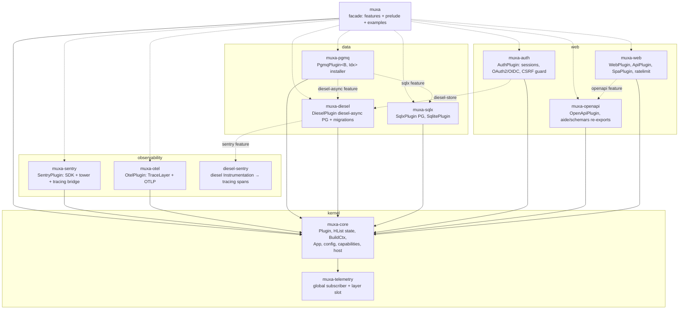
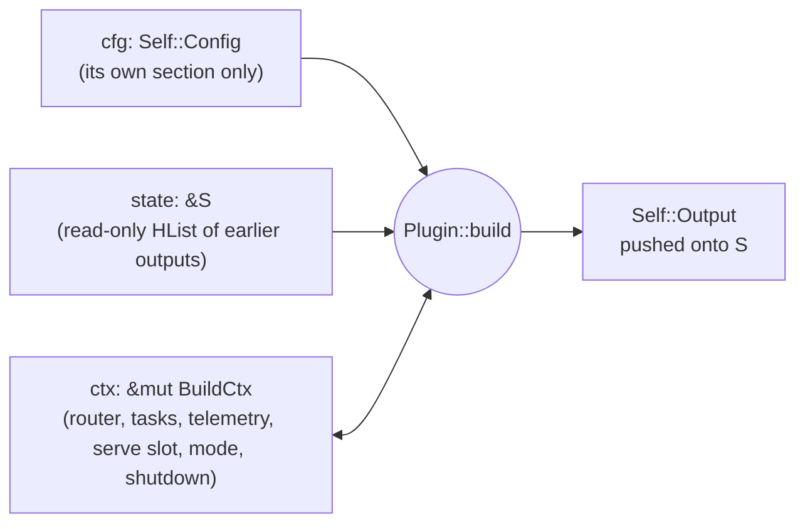
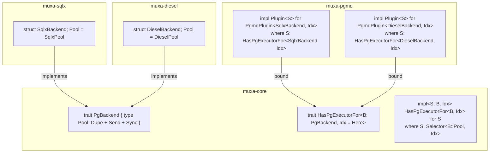
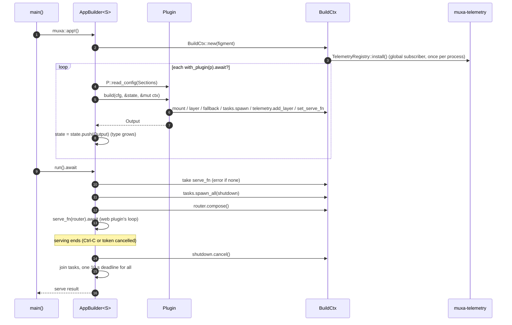
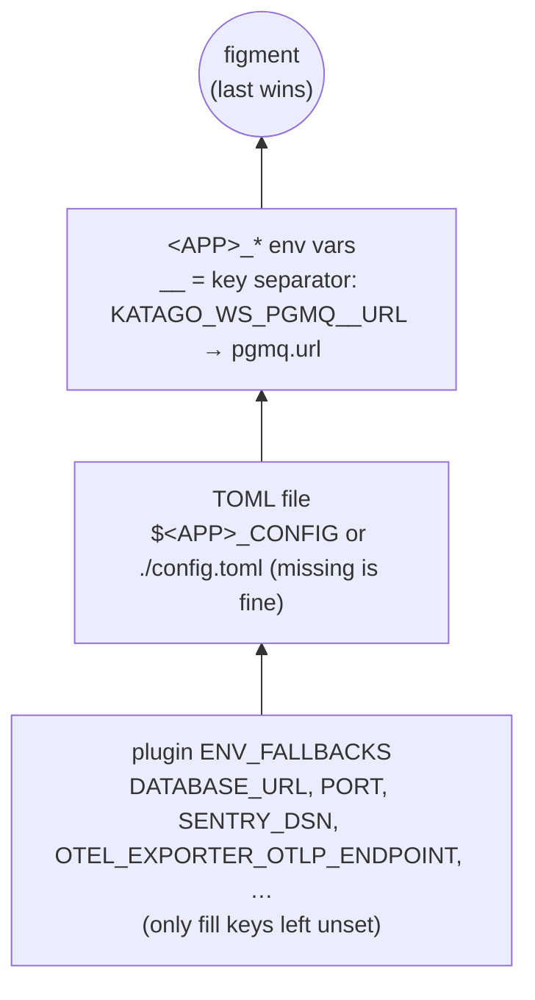
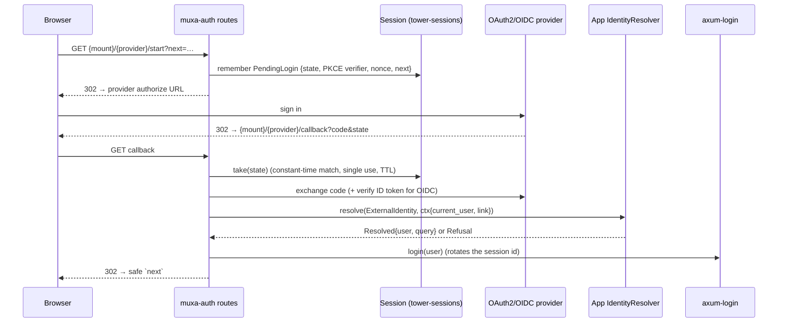

# muxa architecture

muxa is a batteries-included web framework on top of axum 0.8. An application
is a chain of **plugins**. Each plugin reads its own config section, may use
resources that earlier plugins built, contributes one resource of its own, and
can register routes, middleware, background tasks and tracing layers. The
chain is put together **entirely at compile time**: there is no `dyn Plugin`,
no runtime registry and no service locator. A plugin that needs a resource
nobody provides is a type error, not a startup panic.

This document covers the whole system: the crates, the core abstractions, the
build and run lifecycle, what each integration contributes, and the rules that
keep the workspace coherent. `CLAUDE.md` is the shorter working reference;
each crate's `README.md` documents its own API.

---

## 1. The workspace at a glance



Solid arrows are always-on dependencies; dotted ones are behind Cargo
features. Two layers matter:

| Layer | Crates | Knows about integrations? |
|---|---|---|
| **Kernel** | `muxa-core`, `muxa-telemetry` | **No.** Core defines plugins, state, capabilities and the build context. It names *resources* (a Postgres pool), never consumers (pgmq). Telemetry has no idea who adds layers. |
| **Integrations** | `muxa-web`, `muxa-sqlx`, `muxa-diesel`, `muxa-pgmq`, `muxa-otel`, `muxa-sentry`, `muxa-auth`, `muxa-openapi` | Each wraps one ecosystem crate as a `Plugin`. They reach each other only through capability traits in core, or through explicit optional deps (`muxa-pgmq` → pool crates, `muxa-auth` → `muxa-diesel` for its store). |
| **Facade** | `muxa` | Re-exports everything behind top-level features and provides `muxa::prelude`. Apps depend on this crate alone. |

`diesel-sentry` is framework-agnostic (no muxa dependency). `muxa-diesel`'s
`sentry` feature wraps it.

---

## 2. Core abstractions (`muxa-core`)

### 2.1 The `Plugin` trait

```rust
pub trait Plugin<S: State>: Sized + Send + 'static {
    type Output: Send + Sync + 'static;           // resource pushed onto the state
    type Config: DeserializeOwned + Default + Send + 'static;
    const CONFIG_PREFIX: &'static str;            // "" = no config
    const ENV_FALLBACKS: &'static [EnvFallback] = &[];

    fn build(self, cfg: Self::Config, state: &S, ctx: &mut BuildCtx)
        -> impl Future<Output = Result<Self::Output>>;   // NOT required to be Send

    fn read_config(sections: &Sections<'_>) -> Result<Self::Config> { /* CONFIG_PREFIX + ENV_FALLBACKS */ }
}
```

A plugin has three inputs and two outputs:



- `Plugin<S>` is generic over the state, so a plugin states what it needs as
  **bounds on `S`** in its `impl`, e.g.
  `impl<S: State + HasPgExecutorFor<SqlxBackend, Idx>, Idx> Plugin<S> for PgmqPlugin<SqlxBackend, Idx>`.
- `Output = ()` means the plugin only acts through `BuildCtx` (web, pgmq,
  openapi, spa).
- **`build` futures are deliberately not `Send`.** `with_plugin` awaits them
  inline on the current task. That lets a plugin run sqlx's
  `Executor<'_> for &mut PgConnection` inside `build` without hitting a known
  HRTB/`Send` inference limitation. Background tasks *are* `Send + 'static`,
  which `tokio::spawn` enforces.

### 2.2 State as a heterogeneous list

`AppBuilder<S>` carries `S`, an **HList** (`muxa-core/src/state.rs`):

```text
App::named("x")                  AppBuilder<HNil>
  .with_plugin(OtelPlugin)       AppBuilder<HCons<TelemetryHandles, HNil>>
  .with_plugin(SqlxPlugin)       AppBuilder<HCons<SqlxPool, HCons<TelemetryHandles, HNil>>>
  .with_plugin(PgmqPlugin::new())AppBuilder<HCons<(), HCons<SqlxPool, …>>>
  .with_plugin(WebPlugin::new(r))AppBuilder<HCons<(), HCons<(), …>>>
```

Every `with_plugin` grows the type by one cell via the `State::Push<T>` GAT.
To read a value back, `Selector<T, Idx>` finds a `T` anywhere in the list.
`Idx` is a type-level path (`Here`, `There<Here>`, `There<There<Here>>`, …)
that the compiler infers. Lookup is resolved statically and costs nothing at
runtime.

The `Idx` parameter exists because of Rust's unconstrained-type-parameter rule
(E0207). A blanket impl over "any list containing `T`" needs some type that
says *where* `T` is.

### 2.3 Capability traits: cross-plugin wiring without orphan problems

`muxa-core/src/capability.rs` holds the pattern for "plugin B needs plugin A's
resource" when B must not depend on A's crate directly:



- The provider crate defines a zero-size **backend marker** that names its
  pool type.
- Core holds **one blanket impl**: any state containing `B::Pool` satisfies
  `HasPgExecutorFor<B, _>`. Pool crates never implement the capability
  themselves, so the orphan rule never comes up.
- The consumer (`muxa-pgmq`) is generic over the backend and writes one
  `Plugin` impl per backend in feature-gated modules. It does not use a trait
  that abstracts over backends, again because of the HRTB/`Send` issue.
- `#[diagnostic::on_unimplemented]` turns a missing provider into a readable
  error: "add the matching pool plugin … before this plugin".
- `Pool: Dupe` makes it explicit that cloning a pool is an `Arc` bump.

Capabilities are named after **resources**, never after consumers. Core
doesn't know pgmq exists.

Most plugins don't need a capability. They take a closure `FnOnce(&S) -> …`
and let the **app** pick what it needs out of the state (`WebPlugin::new(routes)`,
`AuthPlugin::new(parts)`). Capabilities are for plugins that must find a
resource *on their own*.

### 2.4 `BuildCtx`: the side channels

`BuildCtx` (`muxa-core/src/ctx.rs`) is the mutable half of the build. The
state HList is immutable and grows by type; `BuildCtx` stays the same type and
collects everything that isn't a resource:

| Field | Type | Used for |
|---|---|---|
| `mode` | `RunMode` | development / production, resolved once from `[env]` / `<APP>_ENV`, else from the build profile. Plugins choose env-aware defaults from it (Sentry sample rate, banner, …). |
| `router` | `RouterRegistry` | `mount(prefix, router)` (auto-merged), `mount_manual` (the app opts in via `take_manual`), `fallback(router)` (one per app), `layer(fn)` (middleware). |
| `tasks` | `TaskRegistry` | `spawn(name, \|shutdown\| async {…})`. Collected now, **spawned at `run()`**. |
| `shutdown` | `ShutdownToken` | a `CancellationToken` shared by the serve loop and every task. |
| `telemetry` | `TelemetryRegistry` | `add_layer(layer)`, `exclude_targets(&[…])`. See §4. |
| serve slot | `Option<ServeFn>` | `set_serve_fn(…)`. Exactly one plugin (the web plugin) fills it; a second call is an error. |

The configuration is **not** in `BuildCtx`. A plugin only ever sees the
`Config` its own `read_config` produced.

### 2.5 `App` / `AppBuilder`

```rust
muxa::app!()                    // = App::named(env!("CARGO_PKG_NAME"))
    .with_plugin(p1).await?     // read_config → build → push Output
    .with_plugin(p2).await?
    .run().await                // spawn tasks → compose router → serve → drain
```

`with_plugin` wraps any error from `build` in `Error::PluginBuild { plugin, source }`
with the plugin's type name, unless the error is already tagged. A failure
deep in a chain names the plugin it came from.

---

## 3. Lifecycle

### 3.1 Build phase, then run phase



### 3.2 Router composition

`RouterRegistry::compose()` runs once, at `run()`:

1. Every `Mount::Auto` entry, in registration order. Prefix `""` / `"/"` is
   `merge`d, anything else is `nest`ed.
2. The single app-wide **fallback** (`SpaPlugin`) via `fallback_service`. It
   sees the full URI, and nested routers without their own fallback fall
   through to it.
3. **Layers**, in registration order. Each wraps the router built so far, so
   **the last registered layer is outermost**.

Layers are registered in plugin order, so **plugin order is middleware
order**. With a typical chain:

```mermaid
flowchart LR
    req([request]) --> csrf
    subgraph outermost → innermost
        csrf["muxa-auth CSRF guard<br/>(AuthPlugin, added late)"] --> authl["axum-login AuthManager + SessionManager"]
        authl --> sentryl["Sentry NewSentryLayer → SentryHttpLayer"]
        sentryl --> trace["tower-http TraceLayer<br/>(OtelPlugin, added first)"]
    end
    trace --> routes["merged routes<br/>(app routes, auth routes, docs)"]
    routes -. no match .-> fb["fallback (SPA)"]
```

The web plugin only mounts routes and fills the serve slot; it adds no layer,
so its position doesn't affect middleware order. Its `routes` callback runs
during *its* `build`, though, so it can only see resources already in the
state. That is why web goes last.

### 3.3 Serving (`muxa-web`)

`WebPlugin::build` calls the app's `routes(&state)`, mounts the result at `/`,
and registers a `ServeFn`. When `run()` invokes it, the serve loop:

- binds `[web] host:port` (`PORT` env fallback) with a listen **backlog** that
  defaults to the kernel's `somaxconn`, and sets `TCP_NODELAY`;
- prints the startup banner with the composed route list (`[web] banner`,
  on by default);
- serves with `ConnectInfo<SocketAddr>` so per-IP middleware (the rate
  limiter) can read the peer address;
- speaks HTTP/1.1 and, with the default `http2` feature, cleartext HTTP/2 on
  the same port (hyper tells them apart from the first bytes);
- with `graceful-shutdown`, turns Ctrl-C into `shutdown.cancel()`, stops
  accepting, and drains in-flight connections.

`ApiPlugin` is the aide-aware alternative to `WebPlugin`. Its callback returns
an `aide::axum::ApiRouter`. At build it runs `finish_api` into an `OpenApi`
document, mounts the spec and Scalar docs (from `[openapi]`), and schedules the
same serve loop. Use one or the other, never both.

### 3.4 Shutdown

```mermaid
sequenceDiagram
    participant OS
    participant Web as serve loop
    participant Tok as ShutdownToken
    participant T as background tasks
    participant Run as App::run

    OS->>Web: Ctrl-C (graceful-shutdown feature)
    Web->>Tok: cancel()
    Web->>Web: stop accepting, drain connections
    Web-->>Run: serve_fn returns
    Run->>Tok: cancel() (idempotent; covers non-signal exits)
    Tok-->>T: shutdown.cancelled() resolves
    T->>T: flush / drain (otel providers, auth session sweeper, …)
    Run->>T: await all, one 10 s deadline
    Note over Run: panicked tasks logged as failed,<br/>late ones logged as abandoned
```

The OTLP exporters rely on this: `muxa-otel` registers an `otel-shutdown` task
that waits on the token and then flushes the tracer, meter and logger
providers on the blocking pool.

---

## 4. Telemetry (`muxa-telemetry`)

A process has one global `tracing` subscriber, and several plugins want to
add layers to it. `muxa-telemetry` owns that subscriber:

```text
Registry
 ├─ reload::Layer< Vec<Box<dyn Layer<Registry>>> >   ← plugin layers go here
 │    .with_filter( RUST_LOG levels  AND  NOT excluded targets )
 └─ fmt::layer().with_filter( RUST_LOG levels )      ← local logs, always on
```

- It is installed the first time a `BuildCtx` is created, before any plugin
  runs, so early logs already work.
- There is **one reload slot** holding a growable `Vec` of boxed layers, all
  directly on `Registry`. Several typed reload layers can't all sit on
  `Registry`, but one slot with many boxed layers can.
- `add_layer(L)` keeps **one layer per type**. Adding a type that's already
  there replaces it, so a second app built in the same process (tests, a
  rebuild after a failed start) doesn't stack duplicates.
- `exclude_targets(&[…])`: a layer that exports over the network would
  otherwise capture its own transport's events and export those too, an
  amplifying loop. `muxa-otel` excludes the tonic/hyper/h2/reqwest targets on
  its path (plus the `opentelemetry*` SDK crates) and `muxa-sentry` excludes `h2`, `hyper`, `hyper_util`, `reqwest`
  and `tower`. They stay visible to `fmt`. Matching is per crate: excluding
  `tower` hides `tower::…` but not `tower_http`.
- **No per-layer filters inside the slot.** A `Filtered` layer injected
  through `reload` after the subscriber is built never gets a `FilterId` and
  panics. The whole slot is filtered once, at install time. A plugin that
  needs level routing does it inside its own layer; `muxa_sentry::TracingBridge`
  is an example.
- If the app installed its own subscriber first, the registry detaches and
  `add_layer` / `exclude_targets` do nothing.

Who adds what:

| Plugin | Layer(s) added to the slot | Router layer |
|---|---|---|
| `OtelPlugin` | `tracing-opentelemetry` span bridge (`tracing-bridge`), `OpenTelemetryTracingBridge` logs appender (`logs`); global meter provider (`metrics`) | `tower_http::TraceLayer` (`http-layer`, default) |
| `SentryPlugin` | `TracingBridge` (`tracing-bridge`): INFO+ spans → transactions, ERROR events → issues, WARN/INFO → breadcrumbs, INFO+ → structured logs when `[sentry].logs` | `NewSentryLayer` + `SentryHttpLayer` (transactions named after the matched route) |
| `DieselPlugin` + `sentry` | none; `diesel-sentry` emits `tracing` spans tagged with both Sentry (`sentry.op`) and OTel (`db.system`, `db.statement`) conventions, so whichever bridge is installed picks them up | none |

---

## 5. Configuration



- Configuration is **named after the app**, not after muxa: `muxa::app!()`
  uses `CARGO_PKG_NAME`, and the prefix is derived from it (`katago-ws` →
  `KATAGO_WS_`). There is no `MUXA_` prefix and no `App::default()`.
- `App::with_figment(load_figment_from(path, name))` is the escape hatch; the
  examples use it to pin their config file to the manifest dir.
- **Plugins only see named sections.** `Sections::get(prefix)` returns
  `Config::default()` if the section is absent and an error if it is present
  but invalid. `get_or_env` adds the plugin's `ENV_FALLBACKS`. A plugin made
  of several sections (`ApiPlugin` = `[web]` + `[openapi]`) overrides
  `read_config`. Only the app reads the whole configuration, via
  `AppBuilder::figment()`.
- Secrets (DB URLs, Sentry DSN) are `secrecy::SecretString` in the typed
  config, so `Debug` and logs redact them. Raw configuration is never printed.
- `HOST` is never mapped, because shells set it to the hostname.

Sections by plugin:

| Section | Plugin | Notable keys / fallbacks |
|---|---|---|
| `[web]` | `WebPlugin`, `ApiPlugin` | `host`, `port` (`PORT`), `backlog` (default `somaxconn`), `tcp_nodelay`, `banner` |
| `[openapi]` | `ApiPlugin`, `OpenApiPlugin` | spec / docs paths, title |
| `[spa]` | `SpaPlugin` | `exclude_prefixes`, `assets_prefix` |
| `[sqlx]` / `[sqlite]` | `SqlxPlugin` / `SqlitePlugin` | `url` (`DATABASE_URL` for PG), `max_connections` (PG default `host::db_pool_size()`) |
| `[diesel]` | `DieselPlugin` | `url` (`DATABASE_URL`), `max_connections` (default `host::db_pool_size()`), timeouts |
| `[pgmq]` | `PgmqPlugin` | `queues` to create |
| `[otel]` | `OtelPlugin` | `service_name` (`OTEL_SERVICE_NAME`), `endpoint` (`OTEL_EXPORTER_OTLP_ENDPOINT`), timeouts, metric interval |
| `[sentry]` | `SentryPlugin` | `dsn` (`SENTRY_DSN`), `environment`, `release`, `traces_sample_rate` (mode-aware default), `transaction_sample_rates`, `logs`, `http_transactions` |
| `[auth]` | `AuthPlugin` | `base_url`, `mount`, `cookie.*`, `providers.<id>.*`, `trusted_origins`, `cleanup_interval_secs` |
| `env` | core | run mode (`<APP>_ENV`) |

**Host-sized defaults.** Any tunable that depends on the machine defaults from
`muxa_core::host` (`cpus()` respects cgroup quotas and affinity;
`db_pool_size()` is 4 per CPU, clamped to 4–32) or from the kernel
(`somaxconn`). Explicit config always wins. Docs state the rule, not a number.

---

## 6. The integrations, one by one

| Crate / plugin | `Output` | Routes | Router layers | Tasks | Telemetry | Notes |
|---|---|---|---|---|---|---|
| **muxa-web** `WebPlugin::new(routes)` | `()` | app routes at `/` | — | — | — | fills the serve slot; goes last |
| **muxa-web** `ApiPlugin::new(routes, openapi)` (`openapi`) | `()` | finished aide routes + spec + Scalar docs | — | — | — | replaces WebPlugin + OpenApiPlugin |
| **muxa-web** `SpaPlugin::new(spa_assets!())` (`spa`) | `()` | app fallback | — | — | — | memory-serve build: embedded in release, read from disk in debug; `index.html` for client routes, 404 under excluded or asset prefixes |
| **muxa-web** `ratelimit::per_ip_layer` (`ratelimit`) | — | — | apply it yourself on the routes to protect | — | — | tower_governor GCRA, in-memory per process |
| **muxa-openapi** `OpenApiPlugin` | `()` | spec JSON + Scalar | — | — | — | for a pre-built `OpenApi`; re-exports `aide`, `schemars` at the pinned versions |
| **muxa-sqlx** `SqlxPlugin` / `SqlitePlugin` | `SqlxPool` / `SqlitePool` | — | — | — | — | `SqlxBackend` marker → `HasPgExecutorFor` |
| **muxa-diesel** `DieselPlugin` | `DieselPool` (deadpool over `AsyncPgConnection`) | — | — | — | via diesel-sentry spans | optional embedded migrations run in one transaction before the pool is published, serialized across replicas by an advisory lock; `DieselBackend` marker |
| **muxa-pgmq** `PgmqPlugin<B, Idx>` | `()` | — | — | — | — | installs the pgmq schema (embedded SQL) and creates the configured queues on `B`'s pool; queue ops are pgmq's `Queue` trait on a pool connection |
| **muxa-otel** `OtelPlugin` | `TelemetryHandles` | — | `TraceLayer` | `otel-shutdown` (flush) | OTel span/log bridges, global meter | export only when an endpoint is set *and* a transport (`otlp-tonic` / `otlp-http`) is compiled in |
| **muxa-sentry** `SentryPlugin` | `SentryHandle` (holds the `ClientInitGuard` → flush on drop) | — | `NewSentryLayer`, `SentryHttpLayer` | — | `TracingBridge` | no DSN → no-op client; an invalid DSN fails the build without echoing it |
| **muxa-auth** `AuthPlugin::new(parts)` | `AuthHandle` (enabled provider ids) | `{mount}/{provider}/start`, `/callback`, `{mount}/sign-out` | axum-login auth + tower-sessions session layer; cross-origin guard (outermost) | `muxa-auth.sweep` (expired sessions, if the store has a sweeper) | — | the app supplies `AuthnBackend` (its users), `IdentityResolver` (provider identity → user) and a `SessionStore` (`DieselSessionStore` with `diesel-store`) |

### muxa-auth in more detail



- `next` is sanitized (`redirect::safe_next`): only same-site paths, never
  open redirects.
- Refusals become a redirect to `sign_in_path?{error_param}=code`, with
  stable codes: `cancelled`, `expired`, `provider_failed`, `unavailable`,
  `signed_out`, `failed`, plus any the app's resolver returns.
- At most 4 sign-ins can be pending per session (several tabs); the oldest is
  dropped.
- The cross-origin guard follows Go's `net/http.CrossOriginProtection`.
  State-changing requests pass on `Sec-Fetch-Site: same-origin`/`none`, or
  from `base_url` / a trusted origin. Without that header, a request with an
  `Origin` has to match `Host` or be trusted. Combined with `SameSite=Lax`
  cookies, that covers CSRF without tokens.
- `password::{hash, verify}` (feature `password`) hash with argon2 on the
  blocking pool, accept legacy bcrypt hashes and report `NeedsRehash`.
- Handlers extract `AuthSession<B>`, `SessionUser<B>` (401 if signed out) or
  `MaybeSessionUser<B>`.

---

## 7. Plugin ordering rules

| Rule | Why |
|---|---|
| Observability first (`OtelPlugin`, `SentryPlugin`) | Their tracing layers exist before other plugins log during `build`, and their router layers sit innermost, around the handlers. |
| Providers before consumers (`SqlxPlugin` → `PgmqPlugin`, `DieselPlugin` → `AuthPlugin` with a diesel store) | A consumer's `build` reads the provider's output from `S`. Putting the consumer right after its provider lets `Idx` default to `Here`. |
| `AuthPlugin` after the pool its store uses, and before web | Its `parts` closure reads the pool from the state, and its layers wrap the routes. |
| `SpaPlugin` anywhere before web | It only sets the fallback, and there can be only one. |
| **`WebPlugin` / `ApiPlugin` last** | Its routes callback needs the complete state, and it owns the serve loop. |

---

## 8. Dependency and feature policy

- **The facade controls features.** Internal `workspace.dependencies` use
  `default-features = false`. The `muxa` crate gates each integration behind
  a top-level feature (`dep:`) and forwards sub-features with
  `muxa-pgmq?/sqlx`, so a sub-feature without its parent is a no-op instead of
  a build error. `default = ["web", "otel"]`; `full` turns on everything.
- **Standalone binaries.** Nothing in the default graph links a C client
  library. diesel is used through `postgres_backend` / `mysql_backend` (types
  only); diesel-async talks to the server via tokio-postgres / mysql_async.
  The one exception is pgmq's `diesel` feature, which enables `diesel/postgres`
  → libpq. `muxa-pgmq/bundled-libpq` (facade: `pgmq-bundled-libpq`) links a
  static, TLS-less libpq for it. `check-standalone` checks this. TLS is rustls
  everywhere except the opt-in `sqlx-tls-native`.
- **Load-bearing pins.** These are commented in the root `Cargo.toml`; read the
  comments before bumping:
  - `pgmq`: a git rev of the Sagebati fork's `install-only` branch (upstream
    plus a diesel-async SQL installer). It pins `diesel-async 0.9`, which pins
    `diesel ~2.3`, so diesel 2.4 / diesel-async 0.10 wait on a rebase of that
    branch. The same rev is pinned in downstream apps.
  - `aide = "=0.16.0-alpha.4"`, exact, so the `OpenApi` type unifies between
    muxa and the app.
  - `axum-login` and `tower-sessions` move together, as do `tower_governor` and
    `governor`, and all the `opentelemetry*` crates with `tracing-opentelemetry`.
- **Lints are shared with the downstream app** (katago-ws). `[workspace.lints]`
  and `clippy.toml` are identical in both repos, and a change goes to both.
  Highlights: no `unwrap`, no `print*`/`dbg!`, `#[allow]` needs a reason,
  `clone_on_ref_ptr`, `min_ident_chars`.

---

## 9. Adding a new integration

1. Create `crates/muxa-foo`, add it to the workspace `members` and to
   `[workspace.dependencies]` with `default-features = false`, and opt in to
   `[lints] workspace = true`.
2. Define `FooConfig: Deserialize + Default` (hand-write `Default` if
   `#[serde(default)]` must keep `true` booleans), wrap secrets in
   `SecretString`, and default machine-dependent values from
   `muxa_core::host`.
3. `impl<S: State> Plugin<S> for FooPlugin`, with `CONFIG_PREFIX = "foo"` and
   conventional `ENV_FALLBACKS` if any.
4. In `build`, put the resource in `Output`, and routes, layers, tasks and
   tracing layers on `ctx`. Exporting layers call `exclude_targets` for their
   transport crates. Long-lived work goes in `ctx.tasks.spawn` and watches the
   shutdown token so it can flush.
5. If the resource should be found by *other plugins* without them depending
   on you: define a resource-named capability in core (pattern:
   `PgBackend` + `HasPgExecutorFor`) and a backend marker in your crate.
   Otherwise let apps pick it out of the state in their own closures.
6. Add the facade feature (`foo = ["dep:muxa-foo"]`, forward sub-features with
   `?/`), a prelude re-export, a `README.md`, and, if its tests need features,
   a `just` recipe wired into `just check`.

---

## 10. Quality gates

`just check` = `fmt-check` + `lint` (clippy `-D warnings`, plus muxa-auth with
all features) + `test` + `test-pgmq` (both pool backends) + `test-spa` +
`test-auth` + `check-standalone`. Feature-gated code is only covered by its
recipe, so when you touch a crate, test it with the features that compile the
code you changed.

The runnable examples live in `crates/muxa/examples/`: `web_only` (minimal),
`hello` (otel + sqlite + web), `spa`, and `diesel_widgets` (diesel/Postgres
JSON API with migrations, exporting OTLP to a `grafana/otel-lgtm` stack via
docker compose; `just diesel-example`).
